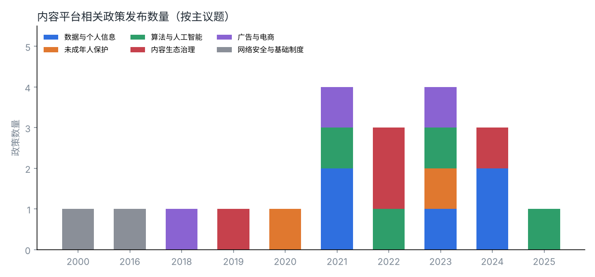
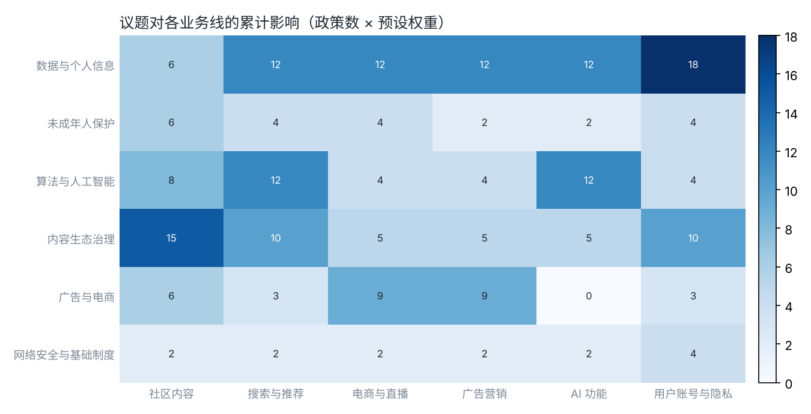

# PolicyRadar：内容平台政策雷达

一个面向**公共事务和政策研究**场景的小工具：把与内容社区平台相关的法律法规整理成结构化数据，自动打上议题标签，评估对各条业务线的影响，并生成政策简报的初稿和可视化图表。

> 公共事务的日常工作，是持续追踪政策、判断它和业务的关系，再把判断写成清晰的简报和沟通材料。这个项目把其中可以标准化的部分（整理、分类、提醒）交给代码，把需要判断的部分（影响分析、沟通口径）留给人。





## 能做什么

| 功能 | 说明 |
|---|---|
| 政策数据库 | `data/policies.csv`：20 份与内容平台相关的法律、行政法规、部门规章和规范性文件，含发布机关、层级、发布日期、施行日期和一句话摘要 |
| 议题分类 | 按关键词把政策归入 6 个议题：数据与个人信息、未成年人保护、算法与人工智能、内容生态治理、广告与电商、网络安全与基础制度 |
| 业务影响评估 | 用「议题 → 业务线」权重矩阵，估算每份政策对社区内容、搜索与推荐、电商与直播、广告营销、AI 功能、用户账号与隐私的影响 |
| 合规日历 | 列出未来一段时间内即将施行的政策，提醒提前准备 |
| 简报初稿 | 一条命令生成 Markdown 简报：近期发布、即将施行、议题分布和建议动作，并留出需要人工判断的部分 |
| 图表 | 政策发布时间线、议题 × 业务线影响热力图 |

## 快速开始

需要 Python 3.10 及以上，以及 matplotlib（只在画图时用到）。

```bash
pip install -r requirements.txt

# 生成某一天的简报初稿
python -m policy_radar brief --today 2025-07-01 --out output/brief_sample.md

# 生成图表
python -m policy_radar charts --outdir output

# 运行测试
python -m unittest discover -s tests
```

生成结果示例：[output/brief_sample.md](output/brief_sample.md)

## 项目结构

```
policy-radar/
├── data/policies.csv          # 政策数据（可自行增补）
├── policy_radar/
│   ├── taxonomy.py            # 议题关键词、业务线、影响权重、建议动作
│   ├── core.py                # 读取数据、分类、影响评估、简报生成
│   ├── charts.py              # 时间线和热力图
│   └── __main__.py            # 命令行入口
├── docs/issue_note_ai_labeling.md  # 议题分析示例：AI 生成内容标识
├── output/                    # 示例输出
└── tests/test_core.py
```

## 方法和局限

- **分类方法**：关键词匹配，一份政策可以属于多个议题；主议题优先取标题里命中的议题。
- **影响权重**：`taxonomy.py` 里的 0–3 分权重是分析假设，不是客观测量，可以按具体公司的业务结构调整。
- **数据范围**：目前是 20 份核心文件的种子数据，用于演示方法。日期和摘要根据公开发布信息整理，**引用前请以官方发布的文本为准**。
- **简报是初稿**：自动生成的部分只负责「有什么」和「什么时候」，「意味着什么」「怎么沟通」需要人来写。`docs/` 里的议题分析就是人工部分的示例。

## 后续计划

- [ ] 接入官方发布渠道的更新，按周自动增补数据
- [ ] 增加地方性法规和行业自律规范
- [ ] 增加「征求意见稿 → 正式稿」的变化对比
- [ ] 可选接入大语言模型，生成政策要点摘要，再由人工核对

## 作者

魏嘉仪 · 伦敦大学学院（UCL）教育规划、经济学与国际发展硕士

本项目在 AI 编程助手的协助下完成：需求设计、议题框架、权重设定和分析文字由作者负责，代码由 AI 辅助编写，作者测试和修改。
